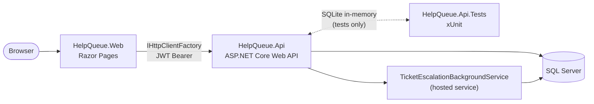

# HelpQueue

[](https://github.com/edu-tech220/helpqueue/actions/workflows/ci.yml)


IT support ticketing platform built as two ASP.NET Core 8 microservices: a **Web API** that owns the
ticket lifecycle, SLA tracking and agent assignment, and a **Razor Pages** frontend that drives it
through `IHttpClientFactory`. No framework ticket templates here — the SLA deadlines, the
least-loaded-agent assignment, the escalation sweep and the reopen window are all real, testable
business rules.

**Stack:** C# / .NET 8 · ASP.NET Core Web API · ASP.NET Core Razor Pages (server-rendered HTML, no
JS framework) · Entity Framework Core · SQL Server (SQLite for tests) · xUnit · Docker · GitHub
Actions.

## What it solves

A small IT department fields support requests (broken laptop, VPN down, access request, printer
jam...) from employees. Each request needs:

- A response/resolution deadline that depends on how urgent it is.
- Someone to work it, picked automatically so one agent doesn't get buried while another is idle.
- A paper trail (comments, some internal-only) and a guardrail so a "fixed" ticket doesn't vanish if
  the problem comes back a day later.
- Visibility for a supervisor across the whole queue, without customers or agents seeing tickets
  that aren't theirs.

HelpQueue models that end-to-end: ticket submission → SLA computation → auto-assignment →
work → resolution → (optional) reopen, with an SLA breach sweep running in the background the whole
time.

## Business rules

- **State machine.** A ticket can only move `New → Assigned → InProgress ⇄ OnHold → Resolved →
  Closed`. Reopening a `Resolved`/`Closed` ticket is a deliberately separate operation, not a plain
  status change — see `TicketTransitions` and `ReopenPolicy`.
- **SLA per priority.** `Low/Medium/High/Critical` each carry a response and a resolution deadline
  (minutes), read from a seeded `SlaPolicies` table and stamped onto the ticket at creation time
  (`SlaCalculator`).
- **Least-loaded auto-assignment under concurrency.** On creation, the ticket goes to the active
  agent with the fewest open tickets, and that agent's workload counter is incremented in the same
  `SaveChanges` call. If two tickets race for the same "most available" agent, the loser's
  concurrency-token check fails, the service reloads the agent's current workload and retries (up to
  5 times) instead of silently overloading or losing the assignment — proven in
  `TicketAssignmentServiceTests`, which reproduces the race deterministically rather than hoping a
  parallel `Task.WhenAll` happens to collide.
- **SLA escalation sweep.** `TicketEscalationBackgroundService` polls every `Escalation:PollingSeconds`
  (default 60s) for tickets past their response or resolution deadline, flags the breach and bumps
  priority — one level up for a response breach, straight to `Critical` for a resolution breach — so
  an overdue ticket surfaces without anyone having to notice the clock ran out.
- **Reopen window.** A settled ticket can be reopened within 7 days and up to 3 times
  (`ReopenPolicy`); outside that window the customer has to file a new ticket. Reopening resets the
  resolution deadline from "now" and gives the workload back to the assigned agent.
- **Role-scoped visibility.** Customers see only their own tickets, agents only what's assigned to
  them, admins see everything. Internal comments (`IsInternal`) are stripped out of the response
  before it ever reaches a customer — not just hidden in the UI.
- **Optimistic concurrency everywhere it matters.** Every status change and reassignment carries the
  ticket's `RowVersion`; a stale value is rejected with `409 Conflict` instead of silently
  overwriting someone else's update. The token is stamped by the app on every insert/update
  (`HelpQueueDbContext.StampConcurrencyTokens`), so it behaves identically on SQL Server and on the
  SQLite database used in tests — no provider-specific `rowversion` column required.

## Architecture



- **HelpQueue.Web** never talks to the database. It holds a cookie-authenticated session whose
  claims include the JWT issued by the Api, and forwards it as a Bearer token on every API call.
- **HelpQueue.Api** owns all business rules and persistence. It's the only thing that can reach
  SQL Server.
- **HelpQueue.Api.Tests** swaps the EF Core provider for SQLite (in-memory) via
  `WebApplicationFactory`, so the whole suite runs with `dotnet test` and no external services.

## Technical decisions

| Decision | Why |
|---|---|
| App-managed concurrency token instead of SQL Server `rowversion` | `rowversion`/`IS ROWVERSION()` is SQL-Server-only, and EF Core's SQLite trigger-based equivalent only materializes through a real migration — not `EnsureCreated()`, which is what the test suite uses. Stamping a fresh `Guid` into a `byte[]` column on every insert/update behaves identically on both providers with zero provider-specific schema. |
| Cookie session on the Web project, JWT between Web and Api | The Razor Pages app never needs its own user store; it reuses the Api's JWT as a claim on the sign-in cookie and replays it as a Bearer token, so the Api remains the single source of truth for auth. |
| Rate limiting is configuration, not a hardcoded constant | `RateLimiting:LoginPermitLimit`/`LoginWindowSeconds` can be raised in tests (or tightened in production) without touching code. |
| RFC 7807 `ProblemDetails` for every error path | Validation errors (via `[ApiController]`), business-rule violations (`TicketWorkflowException` → 409) and concurrency conflicts all come back as the same `application/problem+json` shape, which the Web client parses uniformly. |

## Endpoints

| Method | Route | Roles | Notes |
|---|---|---|---|
| POST | `/api/auth/login` | — | Rate limited (5/min by default). Returns a JWT + role. |
| POST | `/api/tickets` | Customer, Admin | Computes SLA deadlines, attempts auto-assignment. |
| GET | `/api/tickets` | any | Paged, filterable by `status`/`priority`; scoped to the caller's role. |
| GET | `/api/tickets/{id}` | any | 404 if the ticket isn't visible to the caller. |
| PATCH | `/api/tickets/{id}/status` | Agent, Admin | Body includes `rowVersion`; `409` on stale value or illegal transition. |
| POST | `/api/tickets/{id}/reopen` | Customer, Admin | `409` outside the reopen window/limit. |
| POST | `/api/tickets/{id}/reassign` | Admin | Moves workload from the old agent to the new one. |
| POST | `/api/tickets/{id}/comments` | any | `isInternal` comments are rejected from Customers and hidden from them on read. |
| GET | `/api/categories` | any | Reference data for the ticket form. |
| GET | `/api/agents/workload` | Admin | Open-ticket count per agent. |

## Running it

### Docker Compose (Api + Web + SQL Server)

```bash
docker compose up --build
```

- Web: http://localhost:5080
- Api (Swagger): http://localhost:5100/swagger

### `dotnet run` (two terminals)

```bash
dotnet run --project src/HelpQueue.Api
dotnet run --project src/HelpQueue.Web
```

`HelpQueue.Web`'s `Api:BaseUrl` already points at the Api's `http` launch profile port
(`http://localhost:5100`), so both start up with no extra configuration — just make sure a SQL Server
instance matching `ConnectionStrings:DefaultConnection` in `appsettings.json` is reachable (or run
`docker compose up sqlserver` for just the database).

### Demo accounts

Seeded automatically on first run, password **`Passw0rd!`** for all of them:

| Email | Role |
|---|---|
| `admin@helpqueue.dev` | Admin |
| `agent1@helpqueue.dev` / `agent2@helpqueue.dev` | Agent |
| `customer@helpqueue.dev` | Customer |

## Testing

```bash
dotnet test HelpQueue.sln
```

44 tests, no external services: pure unit tests for the state machine/reopen policy/SLA math,
SQLite-backed tests for the escalation sweep and the composed workflow service, a deterministic
concurrency test for auto-assignment, and end-to-end API tests through `WebApplicationFactory`
covering auth, role-scoped visibility, concurrency conflicts and the reopen window.

## Project layout

```
src/HelpQueue.Api/     Web API: domain, EF Core, business-rule services, controllers, JWT auth
src/HelpQueue.Web/     Razor Pages frontend, talks to the Api via IHttpClientFactory
tests/HelpQueue.Api.Tests/   xUnit tests (unit + WebApplicationFactory integration)
```
